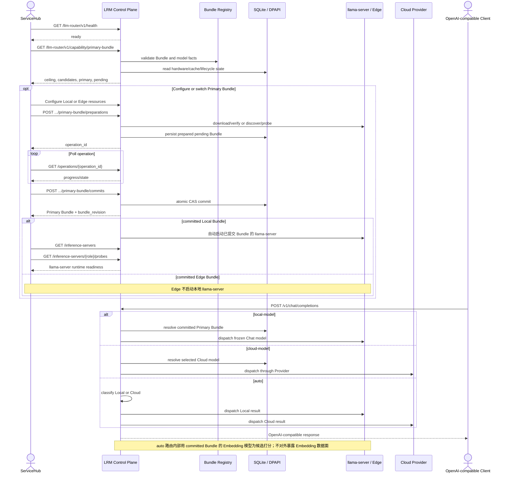

# LLMRouter Manager Guide

## 1. 定位

LLMRouter Manager（LRM）是 Windows Host 上的模型管理与模型 Provider 服务。

- Control Plane 由 ServiceHub 调用，管理模型、Provider、Bundle 和运行状态。
- Data Plane 提供 OpenAI-compatible Chat 和 Models API。
- `full-hdr` 等 `capability_grade` 仅作为 opaque Grade tag 返回；LRM 不解析具体产品或 Agent 行为。

## 2. 当前功能

- 管理可信的原子 Chat + Embedding Bundle。
- 评估硬件支持、模型缓存和下载空间。
- staged prepare、commit、abort Primary Bundle，并持久化 revision。
- 下载、校验、删除 GGUF 模型并管理 llama-server 生命周期。
- 配置和验证 Edge OpenAI-compatible Provider。
- 配置 Cloud Provider、模型选择及 OAuth 登录。
- 通过 `local-model`、`cloud-model`、`auto` 执行 Chat 路由。
- 通过 committed Primary Bundle 的 Embedding 模型为 Auto Router 内部路由打分（不对外暴露 Embedding 数据面）。
- 持久化 token usage 和 operation 状态。
- 提供 ServiceHub 健康、状态、事件和生命周期接口。
- 在 debug 模式提供 OpenTelemetry 配置及诊断接口。

## 3. 统一 Workflow



## 4. Exposed API

除特别说明外，Control Plane 路径均以 `/llm-router/v1` 开头。

Local Bundle 的正式启动顺序是：

```text
prepare Bundle
  -> poll preparation operation
  -> commit Bundle
  -> LRM 自动创建或复用 model_server.ensure_ready operation
  -> 检查 /inference-servers 和 /inference-servers/{role}/probes
```

`POST /capability/primary-bundle/commits` 原子激活 Local Primary Bundle 后，会自动确保该 Bundle 的 llama-server 启动。启动进度和失败通过 `model_server.ensure_ready` operation 暴露；Edge Bundle commit 不启动本地 llama-server。

LRM 启动时也会读取持久化的 active Primary Bundle。若其 backend 为 `llama`、主机符合本地模型资格且两个 GGUF 已完整下载，LRM 自动启动对应的 llama-server；active Edge Bundle 或无 active Bundle 时不启动本地 llama-server。启动恢复不会自动下载模型。

### 4.1 OpenAI-compatible Data Plane

| Method | Path | 功能 |
|---|---|---|
| POST | `/v1/chat/completions` | 使用 `auto`、`local-model` 或 `cloud-model` 执行 Chat，支持 streaming。 |
| GET | `/v1/models` | 返回当前可用的模型路由 alias。 |
| GET | `/v1/pii/level` | 返回 PII 状态；当前固定为 `off`。 |

### 4.2 ServiceHub 与运行状态

| Method | Path | 功能 |
|---|---|---|
| GET | `/llm-router/v1/health` | 返回服务 readiness、PID、版本和实例信息。 |
| GET | `/llm-router/v1/version` | 返回 LRM 版本。 |
| POST | `/llm-router/v1/shutdown` | 请求优雅停止服务。 |
| GET | `/llm-router/v1/status` | 返回硬件、模型、Provider 和 inference server 汇总状态。 |
| GET | `/llm-router/v1/config` | 返回不含 secret 的只读进程配置。 |
| POST | `/llm-router/v1/restart` | 创建服务重启 operation。 |
| GET | `/llm-router/v1/events` | 通过 SSE 输出服务和 usage 事件。 |
| GET | `/llm-router/v1/operations/{op_id}` | 查询 operation 状态和进度。 |
| POST | `/llm-router/v1/operations/{op_id}/cancellations` | 取消 operation。 |

### 4.3 Bundle Capability 与 Lifecycle

| Method | Path | 功能 |
|---|---|---|
| GET | `/llm-router/v1/capability/primary-bundle` | 返回硬件 ceiling、支持的 Bundle、下载可行性及 lifecycle 状态。 |
| POST | `/llm-router/v1/capability/primary-bundle/preparations` | 下载或验证 Local/Edge Bundle，但不激活。 |
| GET | `/llm-router/v1/capability/primary-bundle/preparations/{prepare_operation_id}` | 读回 preparation 的持久化 lifecycle 状态与进度。 |
| POST | `/llm-router/v1/capability/primary-bundle/commits` | 通过 revision CAS 原子激活 prepared Bundle。 |
| POST | `/llm-router/v1/capability/primary-bundle/aborts` | 放弃 pending Bundle 并取消其 operation。 |

### 4.4 Hardware 与 Local Models

| Method | Path | 功能 |
|---|---|---|
| GET | `/llm-router/v1/system/hardware` | 返回检测到的 CPU、GPU、内存等硬件信息。 |
| GET | `/llm-router/v1/system/hardware-eligibility` | 返回本机 Local 模型执行资格。 |
| GET | `/llm-router/v1/system/preflight` | 检查 registry、模型文件和端口 readiness。 |
| GET | `/llm-router/v1/models` | 返回 Local 模型 registry 和持久化状态。 |
| GET | `/llm-router/v1/models/status` | 返回 Local 模型汇总状态。 |
| POST | `/llm-router/v1/models/{id}/downloads` | 启动或返回现有模型下载 operation。 |
| GET | `/llm-router/v1/models/{id}/downloads/latest` | 返回模型最近一次下载 operation。 |
| POST | `/llm-router/v1/models/{id}/verifications` | 校验模型文件完整性。 |
| DELETE | `/llm-router/v1/models/{id}` | 删除未使用的 Local 模型。 |

### 4.5 Model Selection 与 Inference Server

| Method | Path | 功能 |
|---|---|---|
| GET | `/llm-router/v1/model-selections` | 返回各模型角色的持久化选择。 |
| PUT | `/llm-router/v1/model-selections/{role}` | 设置指定角色的模型。 |
| GET | `/llm-router/v1/model-selections/local-provider` | 返回可用 Local backend 和当前选择。 |
| PUT | `/llm-router/v1/model-selections/local-provider` | 选择 `llamacpp` 或 `edge` backend。 |
| GET | `/llm-router/v1/model-selections/tier` | 返回硬件支持的 Chat tier 和当前选择。 |
| PUT | `/llm-router/v1/model-selections/tier` | 选择 tier，并按需下载和启动模型。 |
| DELETE | `/llm-router/v1/model-selections/tier` | 停止 Local server 并清除 tier。 |
| GET | `/llm-router/v1/inference-servers` | 返回 inference server 状态。 |
| POST | `/llm-router/v1/inference-servers/provisions` | 执行 eligibility、下载和启动流程。 |
| GET | `/llm-router/v1/inference-servers/{role}/logs` | 返回指定角色的日志尾部。 |
| GET | `/llm-router/v1/inference-servers/{role}/probes` | 探测指定角色的运行状态。 |
| POST | `/llm-router/v1/inference-servers/{role}/actions` | 对指定角色执行 start、stop 或 restart。 |

### 4.6 Edge Provider

| Method | Path | 功能 |
|---|---|---|
| GET | `/llm-router/v1/edge` | 返回不含 API key 的 Edge 配置。 |
| PUT | `/llm-router/v1/edge` | 验证并加密保存 Edge 配置。 |
| DELETE | `/llm-router/v1/edge` | 删除 Edge 配置。 |
| POST | `/llm-router/v1/edge/test` | 测试已保存或 inline Edge 连接。 |
| GET | `/llm-router/v1/edge/models` | 返回 Edge Provider 暴露的模型列表。 |

### 4.7 Cloud Provider

| Method | Path | 功能 |
|---|---|---|
| GET | `/llm-router/v1/cloud/catalog` | 返回内置 Cloud Provider catalog。 |
| GET | `/llm-router/v1/cloud/providers` | 返回已配置 Provider，不包含 secret。 |
| GET | `/llm-router/v1/cloud/providers/{provider_id}` | 返回单个 Provider 配置。 |
| PUT | `/llm-router/v1/cloud/providers/{provider_id}` | 验证并加密保存 Provider credentials。 |
| DELETE | `/llm-router/v1/cloud/providers/{provider_id}` | 删除未被当前 Cloud model 使用的 Provider。 |
| POST | `/llm-router/v1/cloud/providers/{provider_id}/test` | 测试 Provider credentials 和连接。 |
| GET | `/llm-router/v1/cloud/providers/{provider_id}/models` | 发现 Provider 可用模型。 |
| GET | `/llm-router/v1/cloud/model` | 返回当前 Cloud model 选择。 |
| PUT | `/llm-router/v1/cloud/model` | 设置 Cloud model 和认证方式。 |
| DELETE | `/llm-router/v1/cloud/model` | 清除 Cloud model 选择。 |
| GET | `/llm-router/v1/cloud/model/health` | 检查当前 Cloud model readiness。 |

### 4.8 OAuth

| Method | Path | 功能 |
|---|---|---|
| GET | `/llm-router/v1/oauth/providers` | 返回已有 OAuth session，不包含 token。 |
| GET | `/llm-router/v1/oauth/providers/{provider_id}` | 返回单个 OAuth session 状态。 |
| POST | `/llm-router/v1/oauth/providers/{provider_id}/login` | 启动 PKCE 或 device login。 |
| GET | `/llm-router/v1/oauth/providers/{provider_id}/status` | 查询进行中的登录状态。 |
| POST | `/llm-router/v1/oauth/providers/{provider_id}/cancel` | 取消登录流程。 |
| DELETE | `/llm-router/v1/oauth/providers/{provider_id}` | 删除本地 OAuth session。 |
| POST | `/llm-router/v1/oauth/providers/{provider_id}/refresh` | 强制刷新支持 refresh 的 session。 |

### 4.9 Routing Controls

| Method | Path | 功能 |
|---|---|---|
| GET | `/llm-router/v1/perf-weight` | 返回 Auto Router 的质量/成本权重。 |
| PUT | `/llm-router/v1/perf-weight` | 设置并即时应用 0 到 1 的权重。 |
| GET | `/llm-router/v1/local/ctx-size` | 返回 llama context size 及来源。 |
| PUT | `/llm-router/v1/local/ctx-size` | 设置或清除 context size，并重启 llama-server 应用。 |

### 4.10 Usage

| Method | Path | 功能 |
|---|---|---|
| GET | `/llm-router/v1/usage` | 查询 token usage 汇总。 |
| GET | `/llm-router/v1/usage/events` | 分页查询每次请求的 usage event。 |
| DELETE | `/llm-router/v1/usage` | 清除 usage 汇总和事件。 |

### 4.11 Debug Telemetry

仅在启动时设置 `SUPERCLAW_DEBUG_OBSERVABILITY=1` 时暴露。

| Method | Path | 功能 |
|---|---|---|
| GET | `/llm-router/v1/telemetry/config` | 返回 telemetry 配置。 |
| PUT | `/llm-router/v1/telemetry/config` | 保存并热加载 telemetry 配置。 |
| GET | `/llm-router/v1/telemetry/status` | 返回 exporter 和 runtime 状态。 |
| POST | `/llm-router/v1/telemetry/test-export` | 发送 synthetic telemetry signal。 |
| POST | `/llm-router/v1/telemetry/flush` | 强制 flush telemetry Provider。 |
| POST | `/llm-router/v1/telemetry/reset` | 恢复并应用默认 telemetry 配置。 |

### 4.12 API Metadata 与 Fallback

| Method | Path | 功能 |
|---|---|---|
| GET | `/llm-router/openapi.json` | 返回 OpenAPI schema。 |
| GET | `/llm-router/docs` | 返回 Swagger UI。 |
| GET | `/docs/oauth2-redirect` | Swagger OAuth callback 页面。 |
| Multiple | `/v1/{path:path}` | 为未知 Data Plane 路径返回统一 `not_found`。 |
| Multiple | `/llm-router/v1/system/{path:path}` | 为未知 system 路径返回 `route_not_found`。 |
| POST/PUT/DELETE/PATCH | `/llm-router/v1/models` | 为 models collection 不支持的方法返回 `route_not_found`。 |
| Multiple | `/llm-router/v1/models/{path:path}` | 为未知 models 路径返回 `route_not_found`。 |
| Multiple | `/llm-router/v1/model-selections/{path:path}` | 为未知 selection 路径返回 `route_not_found`。 |
| POST/PUT/DELETE/PATCH | `/llm-router/v1/inference-servers` | 为 inference-server collection 不支持的方法返回 `route_not_found`。 |
| Multiple | `/llm-router/v1/inference-servers/{path:path}` | 为未知 inference-server 路径返回 `route_not_found`。 |

Fallback routes 接受相应 namespace 下未匹配的 `GET`、`POST`、`PUT`、`DELETE` 和 `PATCH` 请求。
